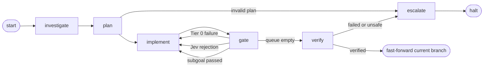

# Jev State Engine: Architectural Blueprint

**Status:** describes the implemented runtime boundaries. Future research and roadmap work remains in [plan.md](plan.md) and [docs/RESEARCH_INTEGRATION_PLAN.md](docs/RESEARCH_INTEGRATION_PLAN.md).

## Prime directive

Never assume or silently hardcode an undefined structural decision. If the engine cannot establish the repository, scope, validation evidence, or branch state it needs, it fails closed or escalates for human review.

## Authority model

The engine uses explicit inversion of control:

- **Engine/FSM:** deterministic authority over lifecycle, routing, strike counters, retries, checkpoints, and branch operations.
- **Worker LLM:** untrusted generator. It can investigate, plan, and mutate only through the tools bound to its current state.
- **Tier 0 workspace checks:** authoritative for local mechanical facts such as syntax/build, compilation, scope, dependency readiness, and test-runner outcomes.
- **Jev gatekeeper:** production semantic authority after Tier 0 passes, plus final ticket verification.
- **Optional advisory provider:** non-authoritative repair guidance. It cannot approve a diff, override a deterministic check or Jev, or write files.

## Runtime topology

The implemented graph is:



### 1. Investigation

`node_investigate` gives the worker read-only repository tools such as directory listing, search, and file reads. Paths are confined to the active repository/worktree. Writes are not available in this state.

### 2. Planning

`node_plan` converts the ticket into typed `Subgoal` objects. Each subgoal declares:

- a description;
- the exact mutation scope;
- whether tests are expected.

The planner is checked against investigation evidence and the declared ticket. Invalid or ungrounded plans escalate instead of inventing files.

### 3. Implementation

Each subgoal receives a dedicated worktree under `.jev-worktrees/subgoal-<id>` and a temporary branch named `jev-subgoal-<id>`. Mutation tools write only within the worktree and reject absolute paths, parent traversal, symlink/junction escapes, and writes under `node_modules`.

The worker may read more broadly than it may write, but every changed path must remain within the declared subgoal scope.

### 4. Two-tier gate

Tier 0 runs deterministic checks before any semantic API call:

1. build/syntax and compile checks appropriate to touched files;
2. suppression and unresolved-import checks;
3. test execution according to `--test-policy`;
4. declared-scope validation.

Only a Tier 0 pass reaches Jev. Jev receives the subgoal, declared scope, diff, mechanical evidence, and available repository notes. A valid result commits the subgoal and advances the integration branch. A rejected result discards the worktree and increments only the semantic strike counter. Mechanical failures increment only the mechanical counter.

Three strikes in either tier escalate. A successful subgoal resets both counters.

### 5. Final verification

When the plan queue is empty, the engine creates a verification worktree from the integration branch. It runs the applicable final checks and asks Jev whether the cumulative diff resolves the original ticket. With `--test-policy never`, tests are excluded rather than reported as passed; compile, scope, and other deterministic checks still apply.

On success, the engine fast-forwards the **currently checked-out target branch** to the integration branch. It refuses to land changes if tracked files changed or the current `HEAD` diverged from the recorded base commit.

## Git isolation and branch lifecycle

```text
target repository/
├── .git/
├── .jev-worktrees/
│   ├── subgoal-<id>/       # branch jev-subgoal-<id>
│   └── verify-<random>/    # detached final-verification worktree
└── project files
```

1. The current target `HEAD` becomes the run's base commit.
2. The engine creates `jev-ticket-<thread-id>` as an integration branch.
3. Subgoal worktrees branch from the integration branch and merge back into it only after both gates pass.
4. Intermediate subgoal branches/worktrees are removed after a successful merge.
5. Final verification fast-forwards the checked-out branch only after all evidence passes.
6. Escalation preserves the integration branch for inspection and leaves the checked-out branch untouched.

The merge is fast-forward-only. The engine does not resolve concurrent changes or create merge commits automatically.

## Checkpointing, ledger, and escalation

LangGraph state is persisted in SQLite using the configured `--db-path` and keyed by `--thread-id`. A repeated thread ID is a clean restart, not an implicit resume: the engine recreates the associated integration branch.

The optional run ledger records runs, subgoals, attempts, diffs, gate results, evidence levels, and role provenance. `--no-ledger` disables ledger recording but does not disable checkpointing. Ledger failures are non-fatal and fall back to a null recorder.

Escalation data is written to the compatibility `escalation.log` path and, when a thread ID is available, to `$JEV_HOME/runs/<thread-id>/escalation.json`.

## Optional advisory role

The CLI can construct an `AdvisoryService` around `OpenAICompatibleProvider` when `ADVISORY_BASE_URL` and `ADVISORY_MODEL` are configured. The provider posts to `<base-url>/chat/completions`, optionally with a Bearer key, and expects a JSON repair brief containing `summary`, `cause`, and `actions`.

Advisory output is bounded and appended as retry guidance. Timeouts, network errors, HTTP errors, and malformed responses are recorded as non-fatal advisory failures. The engine continues with deterministic feedback. DeepSeek is one possible advisory model; it is not a production gate in this path.

## Safety boundaries

Git worktree isolation protects the checked-out branch from intermediate mutations, but it is not a process, container, or OS-level sandbox. Target build and test commands execute with the host user's permissions. Use disposable repositories, keep credentials out of target working trees, and review repository-defined commands before execution.
