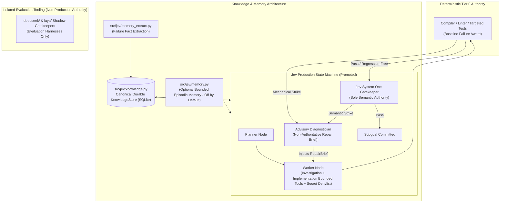

# Implementation Plan: Promoting `eval-shadow-judge` Architecture to Production `master` (Final Approved)

> [!IMPORTANT]
> **Core Architectural Objective**: Promote the high-performance runtime architecture from `eval-shadow-judge` (bounded worker retrieval, policy-aware targeted testing with baseline awareness, advisory diagnostics, and replanning foundations) into `master`, while **strictly preserving** all canonical maintenance and knowledge-engine work from `master` (Phase 4a/4b `KnowledgeStore`, `memory_extract.py`, `scripts/memory.py`, `--model`/`--worker-model`, and `max_investigation_turns`).
>
> **Authority Hierarchy (Immutable)**:
> 1. **Tier 0 (Deterministic Mechanical Authority)**: Subprocess compiler, linter, typechecker, and baseline-aware regression tests.
> 2. **Jev System One (TypeSafe AI Jev, Sole Semantic Authority)**: Autonomous semantic gatekeeper evaluated via `JEV_API_URL` and `JEV_API_KEY`.
> 3. **Advisor Model (DeepSeek / Ollama / OpenAI-compatible Diagnostic Model)**: Non-authoritative, non-blocking repair guidance only. Never approves, never rejects, never writes code, never modifies strike counters or branches.
> 4. **Worker LLM (Untrusted Code Generator)**: Gemini Flash (or model configured via `--model` / `--worker-model`).

---

## Architectural End State



---

## Commit Classification Matrix

### 1. Merge into Promoted Production
* `0e1991f`: Evidence-driven engine safeguards (structured failure packets, retry progress checks, normalized Jev feedback).
* `704cde6`: Provider-agnostic advisory diagnostics abstraction.
* `8c9f688`: Role provenance JSON serialization fix.
* `2a6dbaf`: Retry, structure retrieval, and calibration foundations.
* `5a78804`: Bounded structure retrieval (`AstWorkspaceRetriever`).
* `581d640`: Optional memory & replanning wiring.
* `fbfbb62`: Policy-aware targeted test runner (with baseline failure distinction).
* `068044c`: Production documentation updates.

### 2. Preserve from Current `master`
* `cd6ea3e`: Housekeeping-4: delta on no-change run, `max_investigation_turns`, test-output decoding, and worker model config.
* `9eab90a`: Follow-up housekeeping-4: remove `max_turns` parameter and isolate gatekeeper in model test.
* `b561584`: Phase 4a: memory extractor for `CompileTrap` facts.
* `a7db4bb`: Follow-up phase-4a: feedback parsing, `<TMP>` tokens, Windows paths, bracket stripping, basename fallback, and empty code formatting.
* `638dd34`: Phase 4b-1: diff delta `fix_hint`, `evidence_paths`, and `repo_key` resolution.
* `3fc55e7`: Fix `fix_hint` rendering to use failed/passing attempt only sections.
* `857b5fe`: Phase 4b-2: Implement `KnowledgeStore`, evidence capture, staleness tracking, and `NullMemory`.
* `6e07d8d`: Phase 4b-3: Implement `scripts/memory.py` CLI and update `KnowledgeStore.forget` to return deleted count.

### 3. Keep Strictly Evaluation-Only (Isolated from Production Path)
* `77178cf`: Laya and DeepSeek shadow gatekeepers (`laya/`, `deepseek/`).
* `7497459`: Kaggle evaluation server (`deepseek/kaggle_server.py`).
* `10e0cf3`: Shadow provider fixes.
* `ea8c501`: Shadow timeout and heartbeat fixes.

---

## Phase 1: Safe Promotion Branch & Unique Safety Tag

Before modifying any repository state, establish a unique timestamped backup tag and distinct backup branch for zero-risk reference.

### Commands:
```powershell
# 1. Fetch latest commits from remote
git fetch origin

# 2. Ensure master is checked out and up to date
git switch master
git pull --ff-only origin master

# 3. Create unique, timestamped backup tag and separate backup branch
$backupTag = "backup/master-before-eval-promotion-$(Get-Date -Format yyyyMMddHHmmss)"
$backupBranch = "backup/master-before-eval-promotion"

git tag -a $backupTag -m "Backup before eval architecture promotion"
git branch $backupBranch master

# 4. Verify tag and branch existence
git show-ref --verify "refs/tags/$backupTag"
git show-ref --verify "refs/heads/$backupBranch"

# 5. Create promotion branch starting from origin/eval-shadow-judge
git switch -c promote/eval-production origin/eval-shadow-judge

# 6. Initiate the merge of origin/master
git merge origin/master
```

> [!NOTE]
> Merging `origin/master` into `promote/eval-production` uses the eval architecture as the runtime base and layers master's canonical maintenance and knowledge engine cleanly on top.

---

## Phase 2: Surgical File-by-File Conflict Resolution

Resolve conflicts across all overlapping files with exact precision (no automated `--ours` or `--theirs`):

### 1. `src/jev/engine.py`
* **Preserve from `master`**:
  - Worker model support: Support both `--model` and `--worker-model` (compatibility alias) via CLI, plus `JEV_WORKER_MODEL` environment variable.
  - Turn limit: `max_investigation_turns` (default 20).
  - Test output decoding: UTF-8 with `errors="replace"` for cross-platform subprocess safety.
  - No-change run handling: Record empty delta and `"no changes"` summary cleanly on identical commits.
* **Preserve from `eval-shadow-judge`**:
  - Bounded worker read tools: `list_dir`, `grep`, and `read_file` in the implementation node.
  - Structured failure evidence packets (`mechanical_evidence`, `semantic_evidence`).
  - Jev feedback normalization (`normalize_jev_feedback`).
  - Retry intelligence progress checks and duplicate-diff guards.
  - Advisory invocation and telemetry logging.
  - Integration branch lifecycle and targeted test evidence injection.
* **Add Multi-Point Secret Denylist**:
  - Enforce secret file denylist across **both** investigation read tools (`list_dir`, `grep`, `read_file`) and implementation read tools (`read_file`, `list_dir`, `grep`).
  - Block access to: `.env*`, `*.pem`, `*.key`, `id_rsa`, `credentials.json`, `secrets.json`, `.aws/`, `.kube/`.
* **Raw Reasoning Exclusion**:
  - Never log, buffer, or persist raw chain-of-thought (`cot`, `chain_of_thought`, `reasoning_trace`, `hidden_reasoning`) into engine state, trajectory, or ledgers.

### 2. `src/jev/models.py`
* **Preserve Separation of Runtime State vs. Knowledge**:
  - Keep `models.py` focused strictly on runtime state and validation contracts:
    - `Subgoal`
    - `MechanicalCheckResult` (with extended outcome metadata)
    - `ValidationVerdict` (with eval's extended fields: `kind`, `kind_confidence`, `incomplete`, `wrong_behavior`, `conflicts_with_notes`, `extra_answers`)
    - `TestPolicy` enum
    - `State` TypedDict
  - **Do NOT** place `CompileTrap` or `KnowledgeFact` into `models.py`. Keep them within `src/jev/knowledge.py`.

### 3. Knowledge and Memory Architecture Separation
* **Canonical Durable Knowledge Store**: `src/jev/knowledge.py` remains the authoritative SQLite-backed knowledge system (`KnowledgeStore`).
* **Failure Fact Extraction**: `src/jev/memory_extract.py` extracts structured traps from run failures.
* **CLI Inspection**: `scripts/memory.py` provides administrative inspection of the knowledge database.
* **Bounded Episodic Memory**: `src/jev/memory.py` is integrated strictly as an optional, bounded in-run episodic memory layer (**off by default** via `--memory-policy off`). It does not replace or duplicate `KnowledgeStore`.
* **Replanning Primitives**: `src/jev/replanning.py` provides optional, budget-bounded queue replacement on dead ends (**off by default** via `--replanning-policy off`).

### 4. `src/jev/workspace.py`
* Retain master's robust subprocess execution, timeout guards, and path containment.
* Retain eval's targeted test detection, enhanced with **Baseline Failure Awareness** (Phase 4).

### 5. `src/main.py`
* **CLI Arguments & Production Defaults**:
  - Model selection: `--model` and `--worker-model` (alias).
  - Advisory flags: `--advisory-base-url`, `--advisory-model`, `--advisory-api-key`.
  - Advisory policy: `--advisory-policy {off,on,required}` (default: `on`).
  - Memory policy: `--memory-policy {off,on}` (default: `off`).
  - Replanning policy: `--replanning-policy {off,on}` (default: `off`).
  - Diagnostic healthcheck: `--advisor-healthcheck` (one-shot validation; no startup latency).
  - Explicit environment file: `--env-file PATH` (optional).
* **Decouple Target `.env`**:
  - Load exclusively from process environment, `--env-file` (if provided), or engine-root `.env`:
    ```python
    engine_root = Path(__file__).resolve().parent.parent
    engine_env = engine_root / ".env"
    env_file = Path(args.env_file).resolve() if args.env_file else (engine_env if engine_env.exists() else None)
    # STRICT: Never fall back to (repo_dir / ".env") or Path.cwd() / ".env"
    ```

### 6. Documentation (`README.md`, `ARCHITECTURE.md`, `plan.md`)
* Explicitly state the 4-tier authority model:
  - Tier 0: Deterministic Mechanical Authority.
  - Jev System One: Sole Semantic Authority.
  - Advisor Model: Non-Authoritative Repair Guidance.
  - Worker LLM: Untrusted Code Generator.

---

## Phase 3: Production Advisory Subsystem Hardening

Transform the advisory adapter into an enterprise-safe, non-blocking diagnostic helper.

### 1. Advisory Policy Contract (`--advisory-policy`)
* **`off`**: No advisor calls.
* **`on`** *(Production Default)*: Advisory is queried on strikes if configured. If the advisor times out, returns HTTP 404/500, or encounters an error, the engine logs a warning and **continues execution uninterrupted**. Startup **never** calls the advisor.
* **`required`**: Staging/testing only. Halts if the advisory service is unreachable.

### 2. Exact Endpoint Contract in `src/jev/providers.py`
* `ADVISORY_BASE_URL` is defined as the provider root.
* The adapter appends `/chat/completions` directly without heuristic branching:
  - `ADVISORY_BASE_URL=https://provider.example/v1` → `https://provider.example/v1/chat/completions`.
* Timeout is strictly enforced (`timeout=20.0`).
* Healthcheck utility: `python src/main.py --advisor-healthcheck` (separate on-demand check).

### 3. Non-Authoritative Invariants & Mocking Suite
* Advisory advice is strictly natural language guidance injected into the worker's retry prompt (`RepairBrief`).
* Add unit tests verifying that mock advisory outputs (approval, rejection, malformed JSON, timeout, HTTP 404, HTTP 500, contradictory guidance) **never** modify:
  - `gate_status`
  - `valid`
  - `mechanical_strike_count`
  - `semantic_strike_count`
  - `integration_branch`
  - Final verification verdict

---

## Phase 4: Targeted-Test Baseline Failure Isolation

Solve the issue encountered on `my-harness` (where 5 pre-existing broken tests caused mechanical strikes on new cache code).

### 1. Concrete Outcome Classification
In `src/jev/models.py` and `src/jev/workspace.py`, distinguish baseline status instead of a generic `PASSED`:
* `FULL_SUITE_PASSED`: All tests in repo passed cleanly (`full_suite_clean: true`).
* `REGRESSION_FREE_WITH_BASELINE_FAILURES`:
  ```json
  {
    "outcome": "REGRESSION_FREE_WITH_BASELINE_FAILURES",
    "targeted_tests": {
      "outcome": "PASSED",
      "targets": ["tests/cache.test.ts"]
    },
    "baseline_failures": 5,
    "new_failures": 0,
    "full_suite_clean": false
  }
  ```
* `REGRESSION_DETECTED`: New test failures introduced by the current diff.
* `NO_TESTS_COLLECTED`: No matching tests for touched files.
* `EXEMPT_BY_POLICY`: Tests bypassed per `--test-policy`.

### 2. Concrete Evaluation Rules
* **Baseline Qualification**: A global baseline failure is only considered pre-existing if it was observed in an initial baseline test run prior to the subgoal diff, or otherwise independently established.
* **Missing Targeted Test Contract**:
  - `expects_tests=true` + no targeted test found → `NO_TESTS_COLLECTED` → **Mechanical Failure**.
  - `expects_tests=false` + no targeted test found → untested/exempt result → Jev receives explicit evidence.
  - `test_policy=never` → `EXEMPT_BY_POLICY` → no test pass/fail evidence sent to Jev.
* **Regression-Free Qualification**:
  - If targeted tests for touched files pass, and all failing global tests are proven to be pre-existing baseline failures:
    - The subgoal may proceed as **regression-free, not fully green**.
    - The run is **never** recorded as a clean full-suite pass (`full_suite_clean: false`).
    - Baseline failures remain visible in execution logs and ledger telemetry.
    - Final verification explicitly reports baseline failure counts.
    - Jev System One still evaluates the diff for semantic correctness.

### 3. Targeted Test Test Suite
Add test coverage for:
- Baseline failure existing prior to change.
- Identical baseline failure existing after change (regression-free pass).
- New test failure introduced by change (mechanical strike).
- Targeted test passed cleanly.
- `expects_tests=true` + no targeted test found (mechanical failure).
- `expects_tests=false` + no targeted test found (untested pass with explicit evidence).
- `test_policy=never`.

---

## Phase 5: Production Security & Secret Boundary

Enforce strict data boundaries across all subsystems:

### 1. Multi-Point Secret Denylist
Enforce file access restrictions blocking `.env*`, `*.pem`, `*.key`, `id_rsa`, `credentials.json`, `secrets.json`, `.aws/`, `.kube/` across:
* `src/jev/engine.py`: **Both** investigation read tools (`list_dir`, `grep`, `read_file`) and implementation read tools (`read_file`, `list_dir`, `grep`).
* `src/jev/retrieval.py`: AST and structure retrieval.
* `src/jev/workspace.py`: Canonical path containment and worktree safety.

### 2. Comprehensive Payload Redaction
Implement deterministic secret redaction across:
* `src/jev/gatekeeper.py`: Payloads sent to Jev System One.
* `src/jev/providers.py`: Payloads sent to the advisory model.
* `src/jev/ledger.py`: Records persisted to SQLite and disk.
* Escalation logs dumped for human-in-the-loop review.
* Investigation notes, diffs, test output, and repair packets.

### 3. Raw-Reasoning Exclusion
* Prohibit raw chain-of-thought (`cot`, `chain_of_thought`, `reasoning_trace`, `hidden_reasoning`) from being persisted in ledgers, escalation logs, or advisor telemetry.
* Persist only structured diagnostics: `summary`, `cause`, `actions`, `model`, `latency`, `status`, `error_code`.

### 4. Complete Target `.env` Decoupling
In `src/main.py`:
* Ensure credentials load exclusively from process environment, `--env-file`, or `engine_root / ".env"`.
* Never fall back to `repo_dir / ".env"` or `Path.cwd() / ".env"`.

---

## Phase 6: Shadow Evaluation Tool Isolation & CI Guardrails

Ensure research tools remain completely isolated:
* `deepseek/` (`run_tri_test.py`, `tri_shadow_gatekeeper.py`, `kaggle_server.py`) and `laya/` (`run_shadow_test.py`, `shadow_gatekeeper.py`) remain in the repository strictly as offline evaluation harnesses.
* **CI Isolation Checks**:
  - Run static inspection ensuring production code never imports shadow harnesses:
    ```powershell
    Select-String -Path src\main.py,src\jev\*.py -Pattern "deepseek|laya|kaggle_server|tri_shadow"
    # Expected result: No matches found.
    ```
  - Verify production execution never calls tri-eval or Kaggle server.
  - Verify shadow evaluation failures can never block production runs.

---

## Phase 7: Complete Multi-Stage Validation Gates

Run the comprehensive validation pipeline on `promote/eval-production`:

```powershell
# Set environment
$env:PYTHONPATH = "src"

# Gate 1: Bytecode Compilation & Git Cleanliness
python -m compileall -q src tests
git diff --check

# Gate 2: CLI Interface & Help Flag Verification
python src/main.py --help

# Gate 3: Core Engine, Workspace, and Gatekeeper Unit Tests
python -m pytest tests/test_engine.py tests/test_workspace.py tests/test_gatekeeper.py -q

# Gate 4: Durable KnowledgeStore & Memory Extraction Tests
python -m pytest tests/test_memory_extract.py tests/test_knowledge.py tests/test_memory_cli.py -q

# Gate 5: Eval Architecture & Hardening Tests
python -m pytest tests/test_advisory_provider.py tests/test_role_provenance.py tests/test_test_policy.py tests/test_workspace_targeted.py tests/test_retrieval.py -q

# Gate 6: Full Offline Test Suite
python -m pytest -q -m "not live"

# Gate 7: Clean-Environment Installation & Collection Verification
python -m venv .venv-clean
.\.venv-clean\Scripts\Activate.ps1
python -m pip install -r requirements.txt
python -m pytest --collect-only -q
deactivate
Remove-Item -Recurse -Force .venv-clean

# Gate 8: Advisor On/Off Invariant Comparison
# Verify that identical runs with advisor 'on' vs 'off' yield the exact same Tier 0, Jev, and branch outcomes

# Gate 9: Post-Merge Tree Audit
git diff --name-status master...promote/eval-production
git diff --check master...promote/eval-production
git log --oneline --graph --decorate master..promote/eval-production
```

> [!NOTE]
> **Evidence-Based Promotion Criteria**: Promotion requires all mandatory gates to pass, with no unresolved Critical or Required findings. Any expected baseline failures must be documented and classified as non-regressions.

---

## Phase 8: Safe Promotion to `master` & Rollback Standard

Once all mandatory validation gates pass:

```powershell
# 1. Switch back to master
git switch master
git pull --ff-only origin master

# 2. Fast-forward master to the validated promotion branch
git merge --ff-only promote/eval-production

# 3. Push promoted master to remote repository
git push origin master
```

### Standard Rollback Procedure (Zero Force-Push)
If issues arise in production:
* **Release Rollback (Preferred)**: Deploy the previous known-good release tag or commit.
* **Atomic Promotion Commit Revert**:
  ```powershell
  git revert <promotion-commit>
  git push origin master
  ```
* **Range Revert (If multiple commits)**:
  ```powershell
  git revert <oldest-promotion-commit>^..<newest-promotion-commit>
  git push origin master
  ```
*(The unique immutable tag `$backupTag` remains permanently available as an immutable disaster recovery reference).*

---

## Execution Checklist

- [ ] **Phase 1**: Fetch remotes, tag unique `$backupTag`, create `backup/master-before-eval-promotion`, branch `promote/eval-production`, and merge `origin/master`.
- [ ] **Phase 2**: Manually resolve all overlapping files preserving master's `--model`/`--worker-model`, `KnowledgeStore`, `max_investigation_turns`, and eval's bounded tools, retry intelligence, and failure packets.
- [ ] **Phase 3**: Harden `OpenAICompatibleProvider` with strict root `/chat/completions` endpoint, add `--advisor-healthcheck`, and implement `--advisory-policy {off,on,required}` (default `on`, startup non-blocking).
- [ ] **Phase 4**: Implement baseline-aware targeted testing (`REGRESSION_FREE_WITH_BASELINE_FAILURES`) and missing targeted test contracts.
- [ ] **Phase 5**: Add multi-point secret denylist across investigation and implementation read tools, ban raw reasoning traces, and decouple target repo `.env`.
- [ ] **Phase 6**: Add CI checks guaranteeing `deepseek/` and `laya/` are never imported into production runtime.
- [ ] **Phase 7**: Execute all 9 validation gates including `pytest -m "not live"`, clean `.venv` install, and advisor on/off invariant tests.
- [ ] **Phase 8**: Fast-forward merge `promote/eval-production` into `master` and push to origin.
