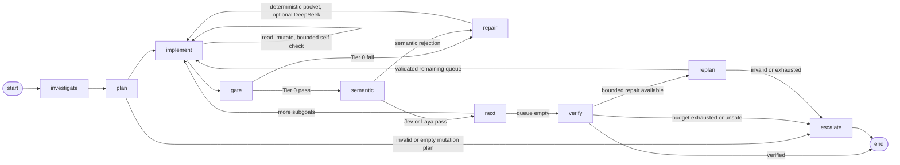

# Jev State Engine 2.0 — Evidence-First Reliability Plan

**Status:** Revised planning document. This file specifies implementation order and evaluation gates; it does not itself authorize source-code changes.

**Baseline:** `master` at `d09d618` (after `--test-policy`).

**Evidence convention:** `ran` means executed and observed; `read` means inferred from source or documentation only.

**Enforcement convention:** `[M]` mechanically enforced; `[P]` prompt-only; `[P+M]` prompt guidance with a mechanical backstop.

---

## 1. Decision summary

The engine should not become a larger, more autonomous machine before it becomes more observable and evidence-driven.

The revised order is:

```text
close security holes
  -> record complete trajectories
  -> give the worker bounded read access
  -> add bounded pre-submit validation
  -> normalize failure evidence
  -> expose structured Jev feedback
  -> add selective DeepSeek diagnosis
  -> enforce evidence-changing retries
  -> add structure-aware retrieval
  -> calibrate Laya and Jev
  -> add re-planning and memory only after measurement
```

### Authority model

- **Tier 0:** deterministic local checks. It is authoritative for build, compile, test, scope, and environment facts.
- **Jev:** paid authoritative semantic judge in production.
- **Laya:** local/open-source semantic replacement mode or shadow judge; never silently mixed with Jev authority.
- **DeepSeek:** advisory diagnostician. It explains evidence and likely root causes; it does not approve diffs or write patches.
- **Worker LLM:** untrusted generator and repair actor operating inside tool, scope, and worktree boundaries.

### Central design rule

```text
Read broadly enough to understand.
Write only within declared scope.
Validate before submission.
Never let an advisory model override a deterministic gate.
```

---

## 2. Problem statement

The current engine has a blind retry failure mode:

```text
worker writes a candidate
  -> compiler, tests, or Jev rejects it
  -> worktree is rolled back
  -> worker receives textual feedback
  -> worker cannot necessarily inspect the missing repository evidence
  -> worker guesses again
  -> repeated strike or escalation
```

The problem is not solved by adding raw chain-of-thought alone. It requires:

1. demand-driven implementation-time repository inspection;
2. bounded self-validation before submission;
3. structured, language-agnostic failure evidence;
4. semantic failure categories from Jev where supported;
5. selective DeepSeek diagnosis when deterministic evidence is insufficient;
6. retry rules that require a changed hypothesis or new evidence;
7. trajectory data that proves whether each change helps.

The worker must not receive the entire repository by default. Context should be retrieved on demand and capped.

---

## 3. Current baseline and known findings

- **FSM:** `investigate -> plan -> implement -> gate -> implement | verify | escalate`, then `verify -> END | escalate`. *read*
- **Isolation:** subgoal worktrees branch from `jev-ticket-<thread_id>`; successful subgoals advance the integration branch; `main` moves only after final verification. *read*
- **Tier 0:** build, suppression, unresolved-import, compile, tests, and scope checks are deterministic; policy controls test execution. *read*
- **Tier 1:** Jev currently receives a Noul validity question and a probability; semantic reasons are limited unless additional typed questions are used. *read*
- **Proven live:** About-page, multi-file Contact-page, and forced-failure scenarios with `main` untouched. *read*
- **Not proven live:** all main-divergence, dirty-tree, interrupt/re-run, and cross-ecosystem scenarios. *read*

### Findings that block safe expansion

| ID | Finding | Evidence | Priority |
|---|---|---|---|
| F1 | A mutation path can escape the worktree if path normalization strips characters rather than only a leading `./`. | `ran` + `read` in the prior investigation. | Critical; Phase 0 |
| F2 | Read-command containment was historically platform-dependent. | `ran` on the prior Linux path. | High; Phase 0 |
| F3 | Jev’s base Noul result may contain probability without a useful textual reason. | `read` and live API observations recorded in the prior plan. | High; Phase 5 |
| F4 | Failed attempts and useful diffs must survive rollback to support repair and calibration. | `read`. | High; Phase 1 |
| F5 | Existing thread IDs restart rather than resume; this must remain explicit. | `read`. | Medium; Phase 0 |
| F6 | Escalation artifacts must be per-run, not overwritten in a shared location. | `read`. | Medium; Phase 0 |
| F7 | Final verification rejection currently escalates rather than attempting bounded repair. | `read`. | Later; Phase 9 |
| F8 | Implementation-time worker context is narrower than investigation context. | `read`. | High; Phase 2 |
| F9 | Worktree-per-subgoal already prevents the old file-level rollback hazard. | `read`. | Preserve; Phase 1 records lineage |
| F10 | Compile-only or semantic-only outcomes must never be mislabeled as test-backed evidence. | `read`. | High; Phase 1/4 |
| F11 | At least one telemetry test failure was observed and remains to be diagnosed before claiming parity. | `ran`. | High; Phase 0 |

---

## 4. Non-negotiable invariants

1. **Inversion of control:** workspace, worker, judge, recorder, profile, and memory are injected; no hidden global authority.
2. **Worktree isolation:** worker writes remain inside the active worktree and declared mutation scope.
3. **Deterministic primacy:** mechanical checks cannot be overridden by Jev, Laya, DeepSeek, or the worker.
4. **Semantic authority clarity:** Jev, Laya, and DeepSeek roles are explicit in every run.
5. **Evidence provenance:** every diagnosis identifies whether it came from deterministic checks, Jev, Laya, DeepSeek, or inference.
6. **Complete attempt recording:** failed attempts are recorded before rollback, including diff hash and relevant diagnostics.
7. **Evidence-changing retries:** a retry must add evidence, change its hypothesis, or change its implementation strategy.
8. **Bounded context:** read output, tool calls, turns, validation cycles, and model calls have hard limits.
9. **Advisory memory:** memory can suggest; it cannot override current repository facts or mechanical results.
10. **Feature flags and shadow mode:** behavior-changing improvements are off by default until held-out evaluation shows benefit.
11. **No raw CoT dependency:** internal reasoning from DeepSeek is not a required persisted protocol; use structured diagnostic summaries.
12. **No OS-sandbox assumption:** Git worktrees are not equivalent to a process/container sandbox. This limitation remains explicit.

---

## 5. Revised architecture



`repair` is a bounded recovery operation. It may be implemented as an internal loop or a graph node, but it must not weaken the existing state-machine authority.

### Worker interaction model

During implementation the worker receives:

- ticket and current subgoal;
- declared write scope;
- bounded relevant file context;
- investigation notes and hard repository profile;
- previous structured failure packet;
- read-only repository tools;
- scoped mutation tool;
- controlled validation tool;
- submit action.

The worker may read outside write scope, but every mutation remains subject to scope and containment checks.

### Failure path model

```text
deterministic failure or semantic rejection
  -> capture evidence before teardown
  -> classify failure
  -> provide targeted read actions
  -> call DeepSeek only when policy says diagnosis is worthwhile
  -> produce bounded repair brief
  -> retry with evidence-change requirement
```

---

## 6. Phased implementation roadmap

### Phase 0 — Close security and lifecycle holes

**Goal:** make current behavior safe and reproducible before adding intelligence.

Plan:

- Centralize strict worktree containment for mutation and read paths `[M]`.
- Reject absolute paths, parent traversal, drive/UNC paths, symlink escapes, and junction escapes `[M]`.
- Preserve dotfiles such as `.env` and `.github`; never normalize by character stripping `[M]`.
- Apply read guards uniformly across platforms `[M]`.
- Diagnose the known telemetry failure F11.
- Mark live API tests so missing credentials produce a skip, not a misleading failure.
- Store escalation artifacts under `$JEV_HOME/runs/<thread_id>/`.
- Keep restart semantics explicit: an existing thread warns and restarts; no implicit resume.
- Verify dirty-tree and main-divergence behavior live in disposable repositories.

Tests/exit criteria:

- traversal, absolute path, dotfile, backslash, symlink, junction, and worktree escape fixtures;
- Windows and Linux parity; macOS when available;
- no writes outside the active worktree;
- `main` remains untouched on escalation;
- all existing non-live tests pass.

### Phase 1 — Ledger, lineage, and trajectory evidence

**Goal:** preserve enough evidence to diagnose failures and evaluate later phases.

Plan:

- Keep stable run, subgoal, attempt, parent-SHA, and commit-SHA records.
- Snapshot every gate outcome before rollback or teardown.
- Store full or bounded diff evidence, diff hash, touched files, diagnostics, test result, compile result, Jev response, model version, usage, and feedback sent.
- Record worker tool calls, read paths, self-checks, and retry number.
- Add explicit provenance fields: `deterministic`, `jev`, `laya`, `deepseek`, or `inferred`.
- Record whether the retry added new evidence or changed its hypothesis.
- Keep `NullRecorder` behavior-compatible and make recorder failure non-fatal.
- Provide a read-only report for runs, subgoals, attempts, lineage, and failure packets.

Tests/exit criteria:

- exactly one attempt row per outcome;
- rows survive rollback;
- recorded SHAs match Git;
- failed diffs are inspectable;
- tool traces and model versions are attached to the correct attempt;
- About and forced-failure tickets produce complete reports.

### Phase 2 — Demand-driven implementation context

**Goal:** eliminate blind retries without flooding the context window.

Plan:

- Add bounded read-only implementation tools:
  - `list_dir`;
  - `read_file`;
  - `grep`;
  - optional manifest/export inspection where deterministic.
- Enforce path containment, ignored directories, output caps, per-attempt call budgets, and total-turn budgets `[M]`.
- Keep mutation tools limited to declared scope `[M]`.
- Give the worker a clear instruction to inspect relevant evidence after import, type, test, or semantic failures `[P]`.
- Record tool calls and results in the trajectory `[M]`.
- Do not inject the entire repository by default.

Tests/exit criteria:

- cross-file import fixtures for TypeScript, Python, Go, Rust, and JVM;
- worker can discover an actual module/export boundary using read tools;
- no read or write escapes containment;
- output and call budgets are enforced;
- initial prompt size remains bounded.

### Phase 3 — Bounded same-turn validation

**Goal:** catch cheap failures before a candidate consumes a gate strike.

Plan:

- Add a controlled validation action selected from the repository profile.
- Prefer the smallest meaningful check:
  - parse/syntax;
  - targeted compile/typecheck;
  - targeted test or test selection where safely discoverable.
- Allow a bounded write -> check -> read-result -> revise loop before submission.
- Return structured diagnostics to the worker.
- Keep authoritative Tier 0 independent; self-check success never guarantees gate success.
- Record every self-check and its latency/output.

Tests/exit criteria:

- common syntax/import/type failures are repaired before submission;
- self-check cannot bypass scope or containment;
- timeout and environment errors are classified separately;
- self-check budgets are enforced;
- final Tier 0 still runs on every submitted candidate.

### Phase 4 — Structured repair evidence and retry guards

**Goal:** turn raw errors into compact, language-agnostic repair context.

Every failure packet should contain:

- failure class;
- check/command;
- affected files and locations;
- baseline versus new errors;
- bounded output excerpt;
- declared versus touched scope;
- tests/compile evidence level;
- known facts;
- unknowns;
- evidence the worker must inspect;
- prior attempt hashes and diff excerpt;
- retry constraints;
- provenance and confidence.

Add mechanical guards:

- identical diff short-circuit before expensive checks `[M]`;
- repeated-hypothesis detection using changed files, diagnostics, read paths, and failure class `[M]`;
- empty implementation diff classification at planning/gate level;
- no semantic call after a mechanical failure;
- no mechanical override by a semantic model.

Tests/exit criteria:

- retries receive compact packets rather than only raw stderr;
- repeated identical diffs call neither tests nor Jev;
- different diffs repeating the same unsupported assumption are detected where possible;
- empty “read-only” subgoals are rejected or routed as investigation work.

### Phase 5 — Structured Jev semantic feedback

**Goal:** obtain authoritative semantic signals before asking DeepSeek to infer them.

Where the provider supports typed questions, collect on rejection:

- incomplete;
- wrong behavior;
- exceeds scope;
- contradicts ticket;
- contradicts repository conventions/notes;
- missing validation;
- unnecessary change;
- low quality;
- primary failure category.

Record:

- raw response;
- model/version;
- probabilities/confidence;
- question set;
- state keys;
- whether the signal came directly from Jev or was inferred.

If the API returns only validity and probability, label the reason as unavailable rather than inventing one.

Exit criteria:

- semantic retries receive typed evidence when supported;
- fallback behavior works when extra questions are rejected;
- no compatibility shim silently changes the authority contract.

### Phase 6 — Selective DeepSeek diagnostic advisor

**Goal:** use reasoning where deterministic evidence is insufficient.

DeepSeek is called only for selected cases:

- repeated mechanical failure;
- ambiguous compiler/test diagnostics;
- semantic rejection with weak Jev feedback;
- repeated failure of the same hypothesis.

DeepSeek receives only a bounded packet:

- ticket and subgoal;
- relevant diff excerpt;
- deterministic diagnostics;
- Jev typed verdict when available;
- selected repository evidence;
- prior attempt summaries.

DeepSeek returns a structured repair brief:

- confirmed facts;
- likely root cause;
- alternative hypotheses;
- evidence still required;
- retry constraints;
- confidence.

DeepSeek must not write files, approve a diff, override Tier 0, or be treated as knowing Jev’s private reasoning. Timeouts and malformed responses fall back to deterministic feedback.

Exit criteria:

- DeepSeek-assisted retries reduce repeated guesses or escalations;
- no increase in false passes, scope violations, or latency beyond the defined budget;
- DeepSeek’s inferred diagnosis is visibly distinguished from Jev’s direct signal.

### Phase 7 — Evidence-driven retry policy

**Goal:** ensure each retry is meaningfully different.

Policy:

- First failure: deterministic packet plus targeted inspection.
- Repeated same-class failure: DeepSeek may be invoked; worker must perform a new evidence-gathering action.
- Identical diff: immediate mechanical/semantic strike of the original tier, no repeated expensive evaluation.
- Repeated hypothesis without new evidence: classify as a dead-end and escalate or re-plan according to budget.
- Never solve the problem by merely increasing the strike limit.

Track whether each retry:

- read new relevant files;
- changed its hypothesis;
- changed its diff materially;
- addressed the failure class;
- changed its validation result.

Exit criteria:

- retry resolution rate improves;
- repeated-guess rate decreases;
- escalation rate falls without increasing final-verification rejection.

### Phase 8 — Repository profile and structure-aware retrieval

**Goal:** reduce context volume while improving relevance across ecosystems.

Keep the hard repository profile for:

- ecosystem/root;
- manifest and package manager;
- module system;
- compile and test commands;
- framework signals;
- evidence level.

Add optional structure-aware retrieval only after Phases 2–7 are measured:

- JavaScript/TypeScript exports/imports;
- Python definitions/imports;
- Go packages/symbols;
- Rust modules/use statements;
- Java/Kotlin classes/packages;
- test-to-symbol relationships.

Use compiler/test locations to rank retrieval targets. Return minimal source slices with paths and line ranges. Fall back to plain search when parsing fails; parser failure must never block read access.

Exit criteria:

- prompt size or repair attempts decrease on a multi-language fixture set;
- successful fixes do not decrease;
- parser failures remain recoverable.

### Phase 9 — Laya replacement calibration and evaluation

**Goal:** make open-source semantic judging measurable and explicit.

Provide distinct modes:

- Jev authority;
- Laya authority;
- Jev authority with Laya shadow;
- diagnostic-only.

Create a labeled, versioned dataset from ledger diffs. Use pilot labels first, then a larger held-out set stratified by:

- ecosystem;
- task type;
- evidence level;
- failure category;
- repository size;
- test availability.

Compare Jev, Laya, and human labels on:

- false pass;
- false reject;
- semantic completeness;
- scope correctness;
- final-verification correlation;
- calibration by model/version.

Passing tests alone is insufficient evidence of correctness.

Exit criteria:

- Laya can run as a documented local replacement with measured limitations;
- shadow decisions are evaluated on held-out cases;
- no authority ambiguity remains in reports.

### Phase 10 — Episodic memory

**Goal:** reuse verified failure/fix patterns without making memory authoritative.

Build memory only from ledger evidence:

- compile traps;
- test traps;
- environment facts;
- later successful repair hints.

Rules:

- provenance points to run, attempt, and commit;
- evidence hashes invalidate stale facts;
- retrieval is exact and budgeted before embeddings are considered;
- memory is `off` by default;
- facts are labeled as hints and rechecked against current code;
- `list`, `forget`, and `rebuild` remain available.

Exit criteria:

- A/B memory-on versus memory-off runs show no regression;
- stale facts are not injected;
- memory reduces repeated failures without overriding current checks.

### Phase 11 — Engine-initiated re-planning

**Goal:** recover from bad decomposition only after retry evidence is available.

Triggers:

- subgoal approaching strike limit;
- final verification rejection;
- oversized or incorrectly decomposed remaining queue.

Rules:

- committed subgoals are immutable;
- only the remaining queue can be replaced;
- invalid plans reuse existing schema and grounding checks;
- hard re-plan budget defaults to one and has a small maximum;
- new subgoals have a count cap;
- dropped work is marked `pruned`;
- worker-initiated scope widening remains disabled.

Exit criteria:

- recoverable failures complete with bounded re-planning;
- unrecoverable failures escalate deterministically;
- re-planning does not increase scope creep or repeat committed work.

### Phase 12 — Calibrated semantic gate

**Goal:** tune decision thresholds only after the ledger and labels justify them.

Plan:

- label a versioned, stratified diff set;
- separate calibration from held-out evaluation;
- analyze Jev probabilities by model version and evidence level;
- compare validity questions with structured choice alternatives;
- run shadow decisions before enforcement;
- handle ambiguous cases by escalation;
- never let mechanical primacy override missing test evidence;
- use stricter policy for critical files such as manifests, lockfiles, and CI configuration.

Exit criteria:

- shadow policy beats the existing threshold on held-out data;
- no increase in final-verification false passes;
- only then enable enforcement behind a flag.

---

## 7. Evaluation program

Before claiming improvement, evaluate a fixed disposable task set across JavaScript/TypeScript, Python, Go, Rust, and JVM repositories.

Required variants:

| Variant | Read tools | Self-check | Structured packet | DeepSeek | Structure retrieval | Purpose |
|---|---:|---:|---:|---:|---:|---|
| Baseline | no | no | no | no | no | Current behavior |
| A | yes | no | no | no | no | Context access |
| B | yes | yes | no | no | no | Pre-submit validation |
| C | yes | yes | yes | no | no | Evidence formatting |
| D | yes | yes | yes | selective | no | Diagnostic advisor |
| E | yes | yes | yes | selective | yes | Structure retrieval |
| F | yes | yes | yes | selective | yes | Laya authority mode |

Record:

- completion and first-attempt success;
- mechanical and semantic strikes;
- repeated-diff and repeated-hypothesis rates;
- escalations by cause;
- final-verification rejection;
- false passes and false rejects;
- scope violations;
- read/self-check/DeepSeek calls and latency;
- token and monetary cost;
- cross-ecosystem performance;
- model and judge versions.

### Success criteria

The plan is successful only if held-out evaluation shows:

1. fewer repeated mechanical failures;
2. fewer repeated guesses and identical diffs;
3. fewer context-related escalations;
4. no increase in scope violations;
5. no increase in semantic false passes;
6. no bypass of Tier 0;
7. measurable benefit beyond JavaScript/TypeScript;
8. DeepSeek failure remains non-fatal;
9. Laya/Jev disagreement is measured;
10. final verification remains the landing authority.

---

## 8. Explicit non-goals for the first implementation cycle

Do not initially add:

- whole-repository prompt injection;
- unrestricted worker shell access;
- DeepSeek as a judge or patch writer;
- raw hidden CoT as a required persisted artifact;
- automatic patch application by the diagnostic model;
- embeddings/vector retrieval before exact retrieval is insufficient;
- larger strike budgets without evidence-change enforcement;
- model fine-tuning before trajectory labels are stable;
- a claim of state-of-the-art performance based only on tests or Jev agreement;
- OS-level sandboxing as an implied property of Git worktrees.

---

## 9. Research basis

The ordering is informed by:

- SWE-agent and mini-SWE-agent: agent-computer interfaces, bounded environment interaction, and inspectable trajectories — https://arxiv.org/abs/2405.15793
- AutoCodeRover: structure-aware retrieval and test-guided localization — https://arxiv.org/abs/2404.05427
- Agentless: staged localization, repair, and validation — https://arxiv.org/abs/2407.01489
- OpenHands: separation of agent, workspace, orchestration, and sandbox placement — https://github.com/OpenHands/OpenHands
- SWE-smith: repository-specific environments and trajectory data — https://arxiv.org/abs/2504.21798
- Agentic Program Repair from Test Failures at Scale: symbolic feedback plus iterative repair — https://arxiv.org/abs/2507.18755
- Thought-Action-Result Trajectories: measurable feedback integration and anti-patterns — https://arxiv.org/abs/2506.18824
- SWE-Bench+: benchmark leakage and weak-test warnings — https://arxiv.org/abs/2410.06992

The research does not prove that any one design is universally best. It supports the engineering principle used here:

```text
targeted context
  -> executable feedback
  -> evidence-driven repair
  -> independent validation
  -> transparent trajectory
```
